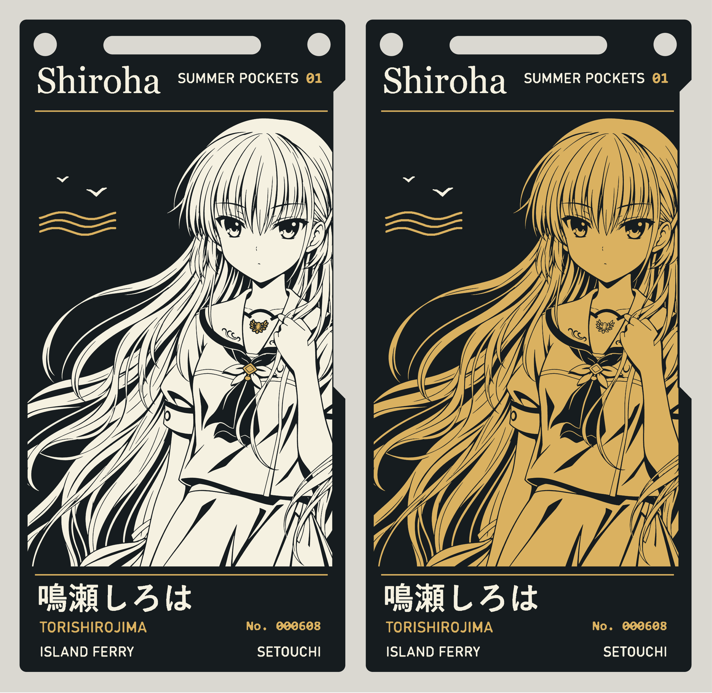
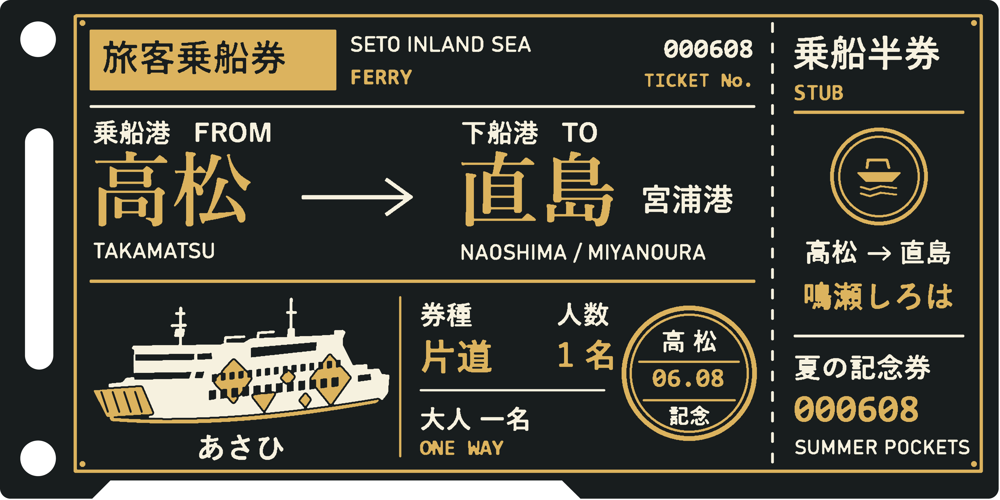
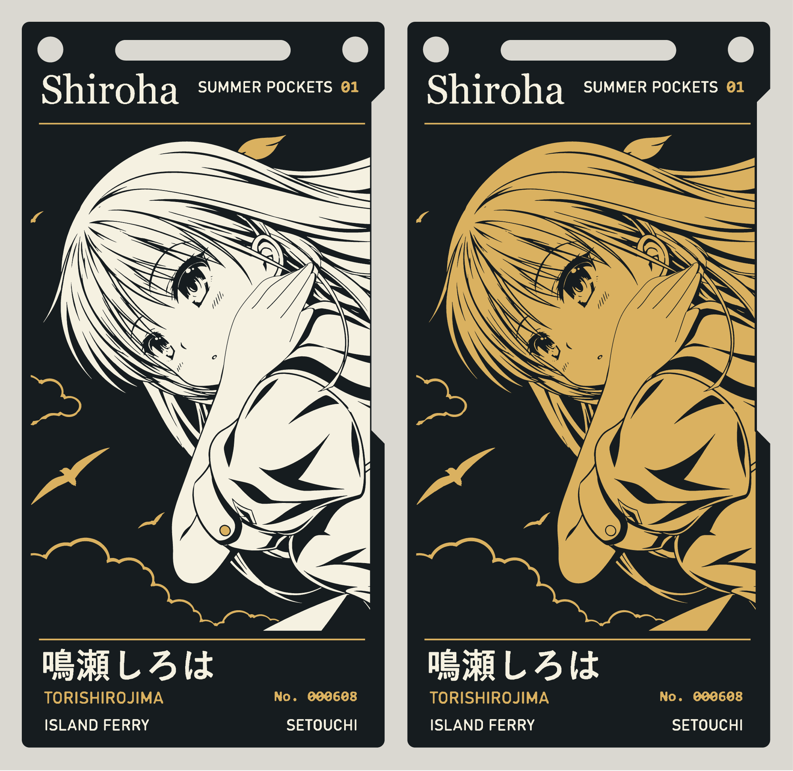
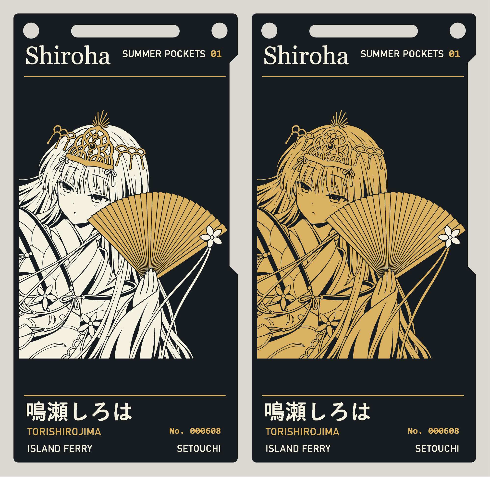
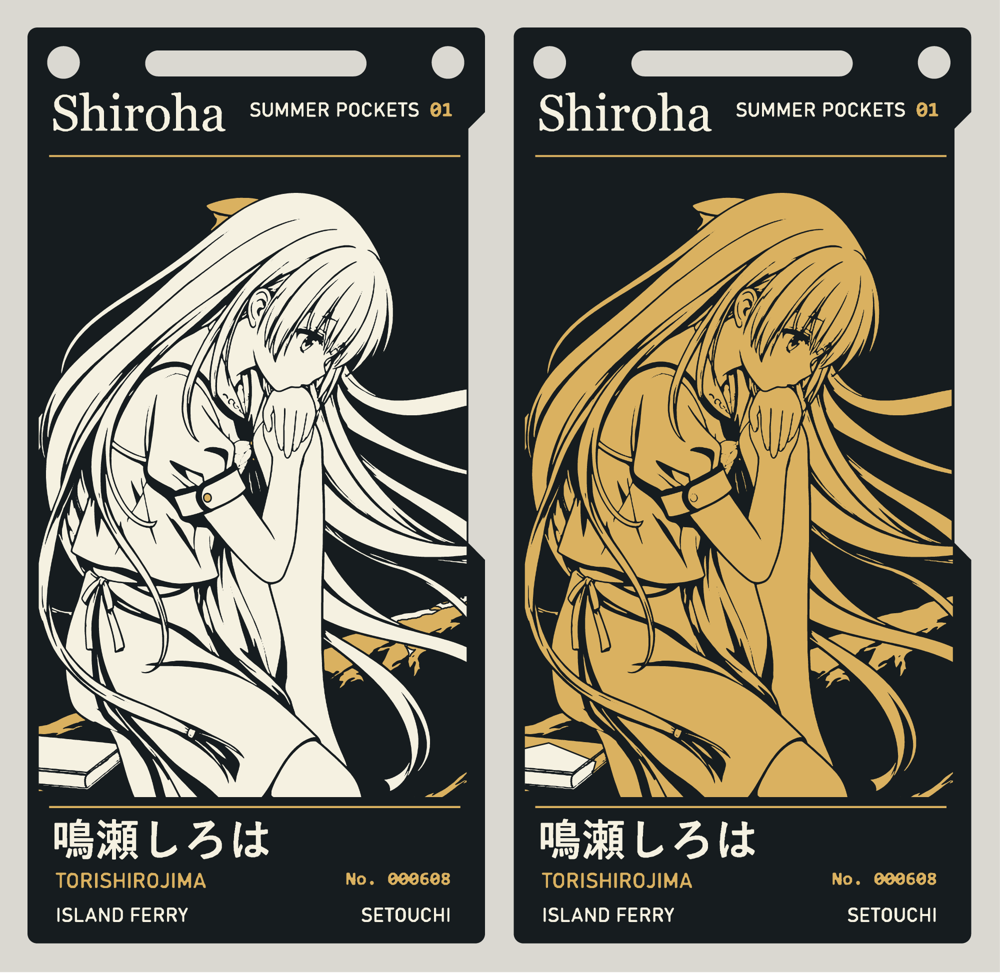
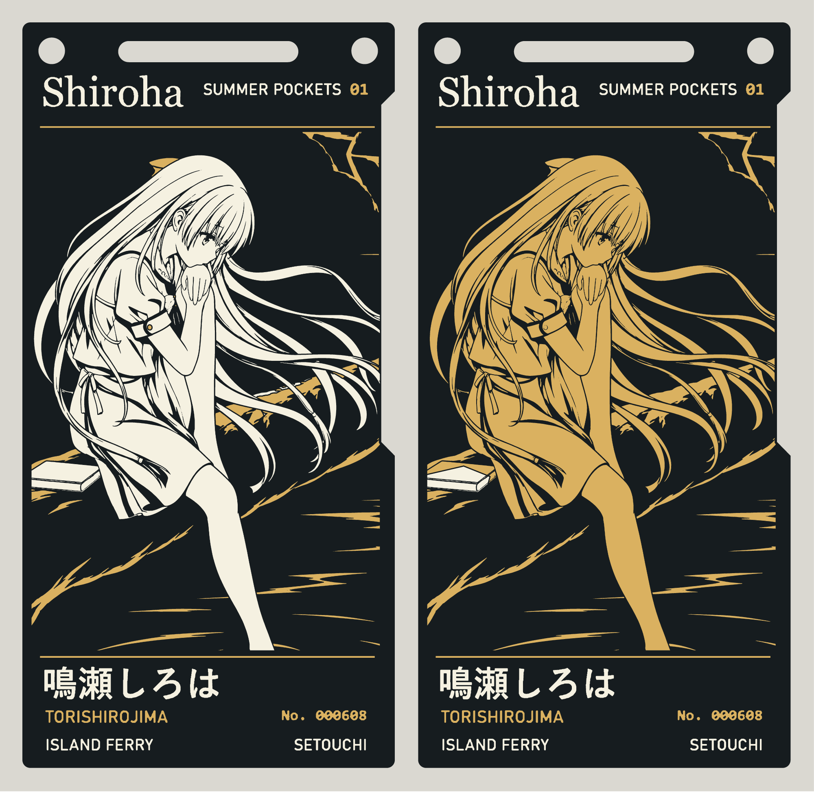
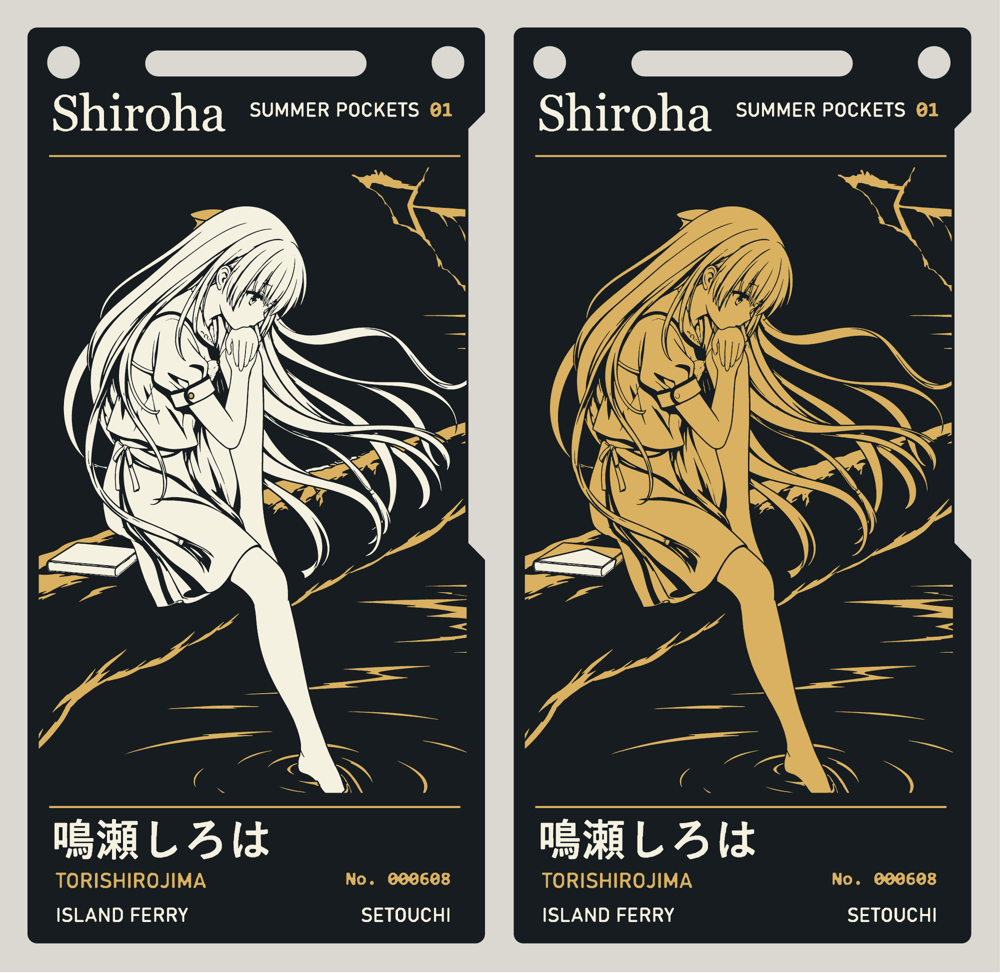
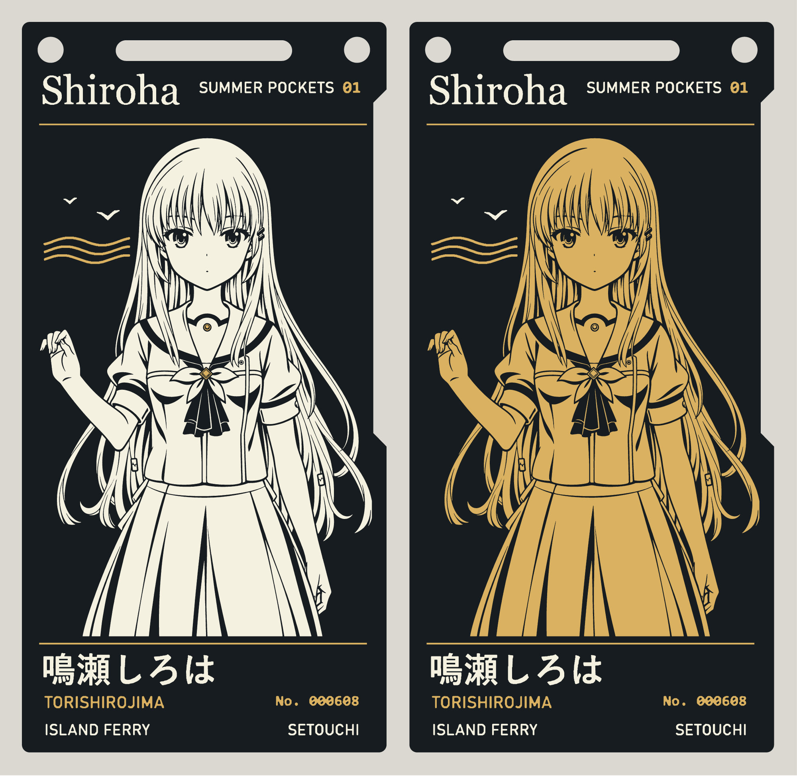

# Shiroha Naruse · Setouchi Ferry Ticket PCB

[简体中文](README.md) · [English](README.en.md) · [日本語](README.ja.md)

**Game artwork** · Left: a black-and-white character with gold accents. Right: a black-and-gold character. Click any image to view it at full size.

[Black-and-white project](boards/game/game.epro2) · [Black-and-white Gerber](boards/game/gerber.zip) · [Black-and-gold project](boards-character-gold/game/game.epro2) · [Black-and-gold Gerber](boards-character-gold/game/gerber.zip)

The current manufacturing version is **v1.3.4**. This public repository contains the current version; earlier versions are kept in private archives. Seven designs each have black-and-white and black-and-gold variants, for a total of fourteen double-sided PCBs. All board views below are rendered from their corresponding manufacturing layers.

[All manufacturing files](https://github.com/shiroha777777/shiroha-ferry-pcb/releases/download/v1.3.4/Shiroha-14-Gerbers.zip) · [Black-and-white project bundle](https://github.com/shiroha777777/shiroha-ferry-pcb/releases/download/v1.3.4/Shiroha-Black-White-Accessories-7.zip) · [Black-and-gold project bundle](https://github.com/shiroha777777/shiroha-ferry-pcb/releases/download/v1.3.4/Shiroha-Character-Black-Gold-7.zip) · [1200 dpi front and back PNGs](https://github.com/shiroha777777/shiroha-ferry-pcb/releases/download/v1.3.4/Shiroha-1200dpi-PNG.zip)

v1.3.4 repairs the hand holding a lock of hair in the game design and adjusts the fingertips, finger separation and palm outline in the blue-sky design using the original artwork. In the golden-fan design, the fan and headdress use ENIG gold, while the flower on the fan remains white silkscreen. Both color variants, their project files, Gerbers and images below are synchronized within the existing v1.3.4 tag. The approximately 0.32 mm board-edge clearance is retained. [Manufacturing notes (Chinese)](FABRICATION.md) · [Revision verification](art-revision-review.json) · [Game hand verification](hand-repair-review.json)

## Back of the board

All seven designs in both color variants share this back: Takamatsu → Naoshima, Miyanoura; vessel name “あさひ” (Asahi); date June 8 (06.08). This image is rendered from the actual back-side Gerber. Click to enlarge.

## Other designs

Each image shows the black-and-white variant on the left and the black-and-gold variant on the right.

### Blue sky

[Black-and-white project](boards/blue-sky/blue-sky.epro2) · [Black-and-white Gerber](boards/blue-sky/gerber.zip) · [Black-and-gold project](boards-character-gold/blue-sky/blue-sky.epro2) · [Black-and-gold Gerber](boards-character-gold/blue-sky/gerber.zip)

### Golden fan

Both variants have a gold fan, black rib lines and a white flower on the fan.

[Black-and-white project](boards/golden-fan/golden-fan.epro2) · [Black-and-white Gerber](boards/golden-fan/gerber.zip) · [Black-and-gold project](boards-character-gold/golden-fan/golden-fan.epro2) · [Black-and-gold Gerber](boards-character-gold/golden-fan/gerber.zip)

### Riverside · close-up

[Black-and-white project](boards/riverside-close/riverside-close.epro2) · [Black-and-white Gerber](boards/riverside-close/gerber.zip) · [Black-and-gold project](boards-character-gold/riverside-close/riverside-close.epro2) · [Black-and-gold Gerber](boards-character-gold/riverside-close/gerber.zip)

### Riverside · medium view

[Black-and-white project](boards/riverside-medium/riverside-medium.epro2) · [Black-and-white Gerber](boards/riverside-medium/gerber.zip) · [Black-and-gold project](boards-character-gold/riverside-medium/riverside-medium.epro2) · [Black-and-gold Gerber](boards-character-gold/riverside-medium/gerber.zip)

### Riverside · wide view

[Black-and-white project](boards/riverside-wide/riverside-wide.epro2) · [Black-and-white Gerber](boards/riverside-wide/gerber.zip) · [Black-and-gold project](boards-character-gold/riverside-wide/riverside-wide.epro2) · [Black-and-gold Gerber](boards-character-gold/riverside-wide/gerber.zip)

### Anime artwork

[Black-and-white project](boards/anime/anime.epro2) · [Black-and-white Gerber](boards/anime/gerber.zip) · [Black-and-gold project](boards-character-gold/anime/anime.epro2) · [Black-and-gold Gerber](boards-character-gold/anime/gerber.zip)

## Ordering a PCB

Extract the manufacturing bundle and choose `standard` (black-and-white) or `variant` (black-and-gold). Upload the individual Gerber ZIP for the design you want. Use two-layer FR-4, 1.6 mm thickness, 1 oz copper, black solder mask, white silkscreen and ENIG. The back is already written in manufacturing coordinates; switch to the bottom view in a Gerber viewer to check the text. PNGs are for viewing and printing at physical size.

This version prioritizes artwork detail and is no longer constrained to be easier to manufacture than the Kurisu board. Some fine hair, eye, headdress and fan-rib features remain below conventional line-width or spacing limits. The files have been generated and checked, but have not received factory CAM acceptance or physical-board validation. This detail-preserving version must not be described as having passed all DFM checks. How fully the artwork is reproduced depends on the manufacturer's capabilities.

The contours of all six manufacturing layers in each of the fourteen projects have been checked point by point against their Gerbers. Top copper and solder-mask openings match. The board outline, drill files and three back-side layers are identical to v1.3.1. White silkscreen is kept approximately 0.155 mm away from exposed copper; fine internal artwork lines are not forcibly removed or thickened. [Manufacturing notes and per-design screening (Chinese)](FABRICATION.md) · [Verification data](manufacturing-review.json) · [JLCPCB manufacturing capabilities (Chinese)](https://www.jlc.com/portal/vtechnology.html)

## References and acknowledgments

This project references [observer0703's Kurisu ENIG PCB](https://github.com/observer0703/-kurisu-enig-pcb), specifically [v1.0.0, including its project files and manufacturing guide](https://github.com/observer0703/-kurisu-enig-pcb/releases/tag/v1.0.0). Thank you to the author for sharing the project and production experience.

The board shape, lanyard holes and slot, and base project are reused from that reference. Its use of black solder mask, white silkscreen and ENIG gold also informed the material-layer presentation. The Shiroha artwork, lettering, and front and back ferry-ticket layouts were redesigned on that basis. See the [source notice (Chinese)](NOTICE.md) for the scope of rights covering the upstream design and character materials.

Another related reference is [adenzhou1350's ENIG PCB Art collection](https://github.com/adenzhou1350/enig-pcb-art), which brings together black-and-gold PCB artwork, material-layer documentation, project build tools and reproduction guides. Thank you to the author for sharing these designs and production resources.

## Sources and license

The original ferry-ticket layout, layer artwork and PCB modifications created for this project are licensed under CERN-OHL-P-2.0. Character and source-art rights remain with their respective rights holders. [Sources and scope (Chinese)](NOTICE.md) · [License](LICENSE)
