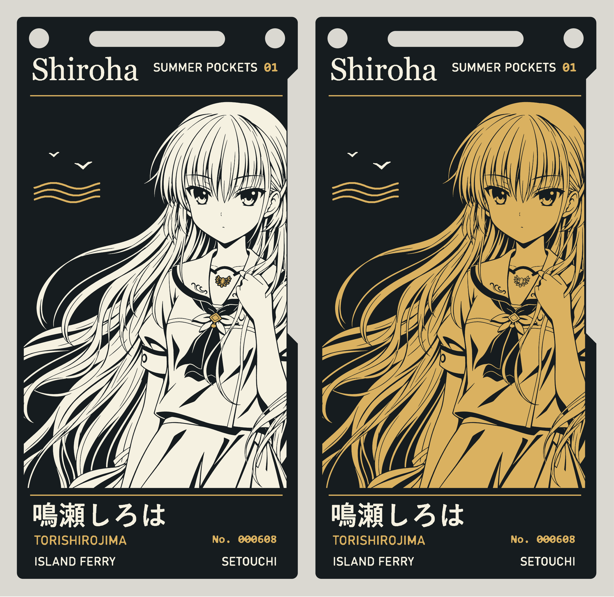
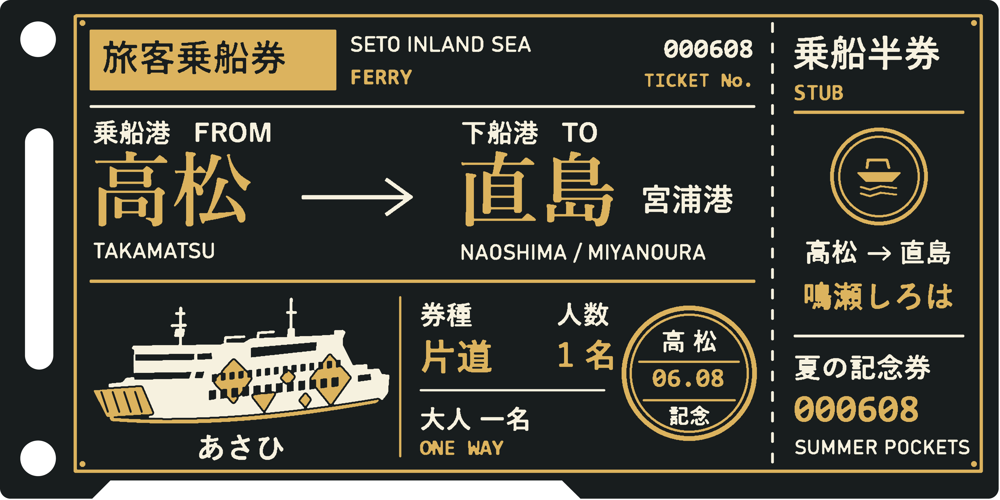
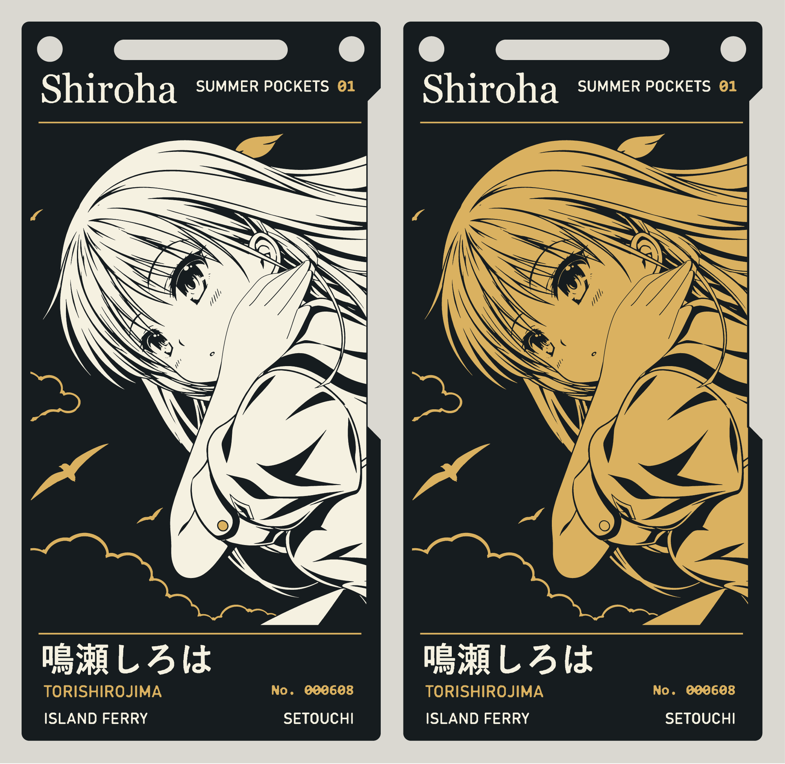
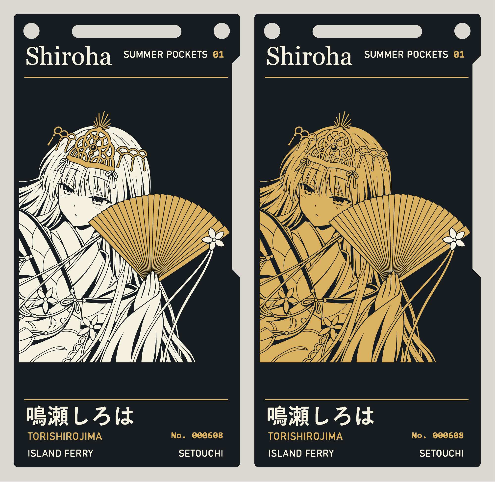
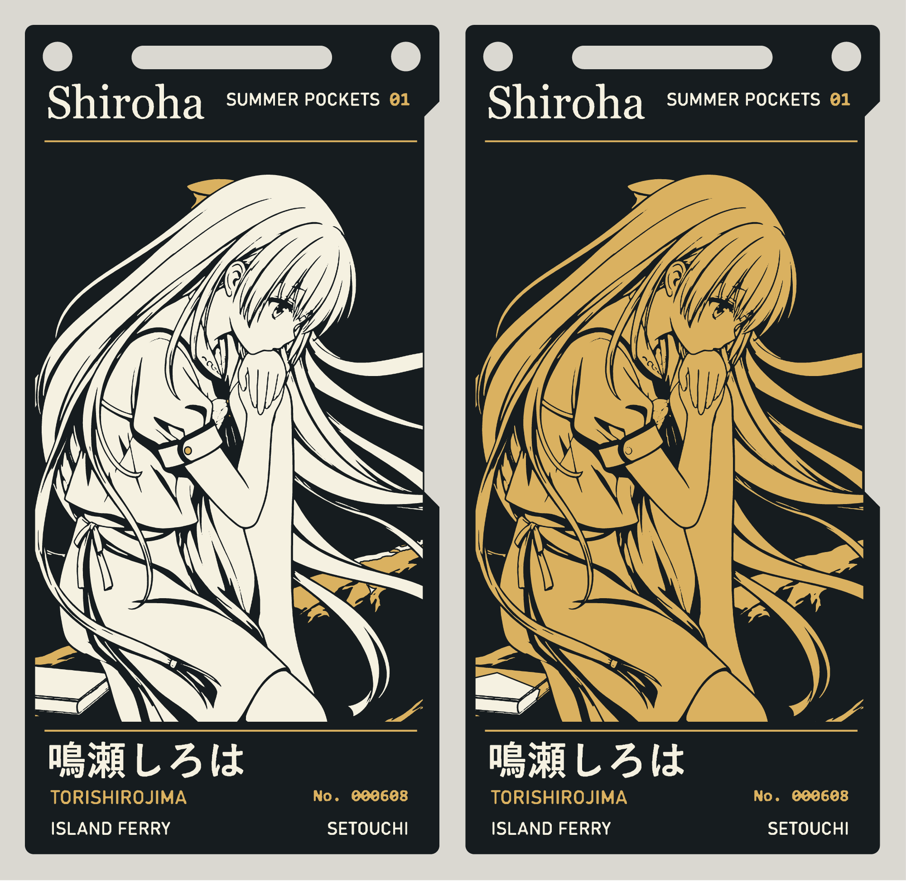
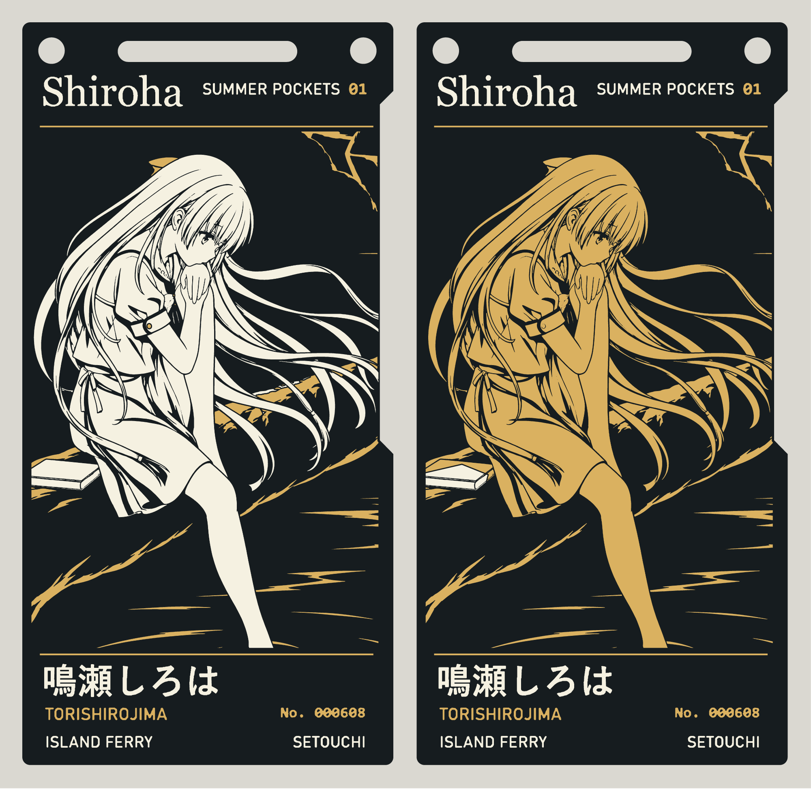
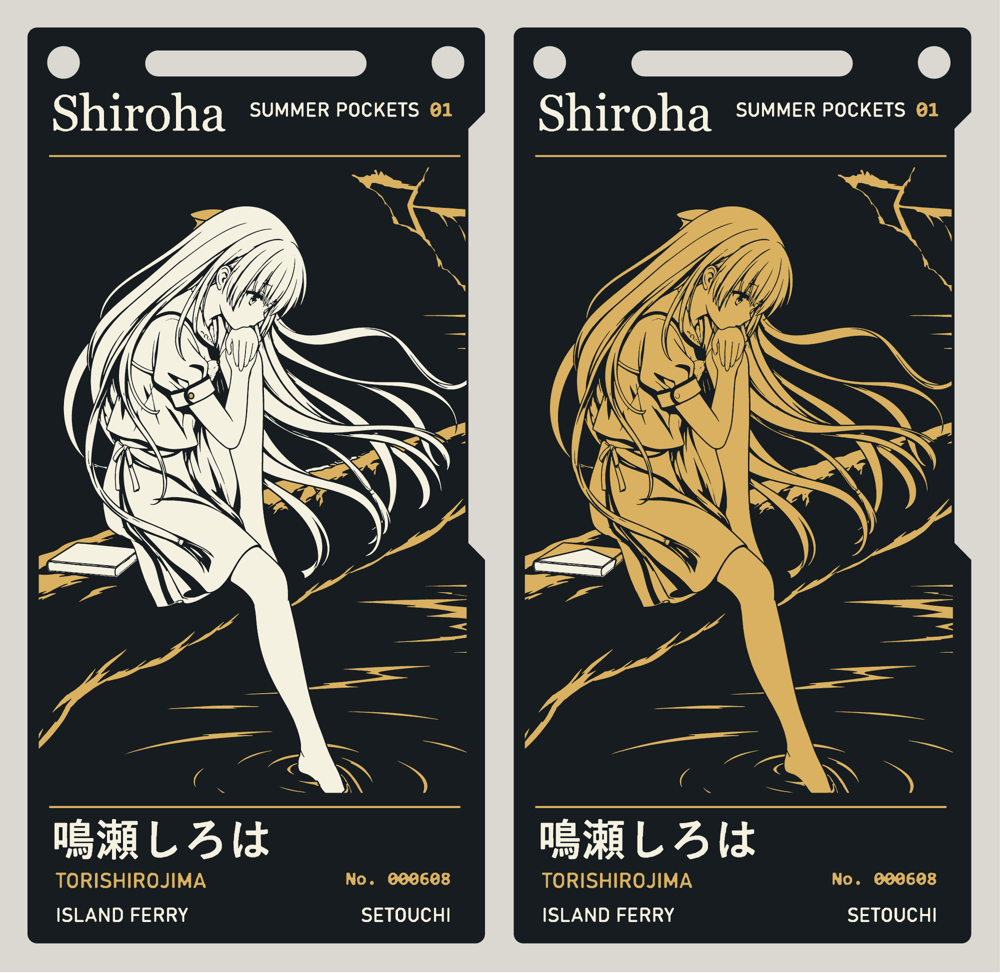
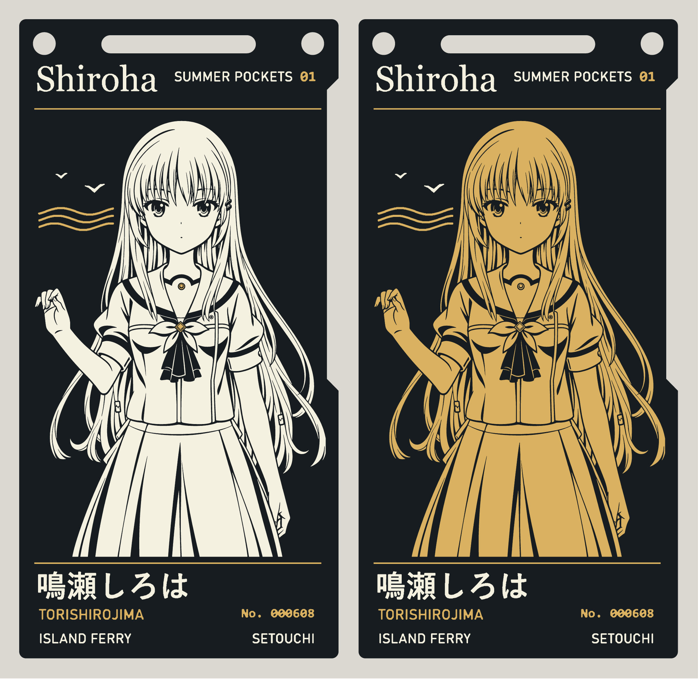

# 鳴瀬しろは · 瀬戸内フェリーチケット PCB

[简体中文](README.md) · [English](README.en.md) · [日本語](README.ja.md)

**ゲーム立ち絵** · 左：人物は白黒、装飾は金色。右：人物は黒と金。画像をクリックすると拡大表示できます。

[白黒版プロジェクト](boards/game/game.epro2) · [白黒版 Gerber](boards/game/gerber.zip) · [黒金版プロジェクト](boards-character-gold/game/game.epro2) · [黒金版 Gerber](boards-character-gold/game/gerber.zip)

現在の製造データは **v1.3.4** です。この公開リポジトリには現行版を掲載し、旧版は非公開で保管しています。7 種類のデザインに白黒版と黒金版があり、合計 14 セットの両面 PCB を用意しています。以下の基板画像は、対応する製造レイヤーから描画したものです。

[製造データ一式](https://github.com/shiroha777777/shiroha-ferry-pcb/releases/download/v1.3.4/Shiroha-14-Gerbers.zip) · [白黒版プロジェクト一式](https://github.com/shiroha777777/shiroha-ferry-pcb/releases/download/v1.3.4/Shiroha-Black-White-Accessories-7.zip) · [黒金版プロジェクト一式](https://github.com/shiroha777777/shiroha-ferry-pcb/releases/download/v1.3.4/Shiroha-Character-Black-Gold-7.zip) · [表裏の 1200 dpi PNG](https://github.com/shiroha777777/shiroha-ferry-pcb/releases/download/v1.3.4/Shiroha-1200dpi-PNG.zip)

v1.3.4 では、ゲーム立ち絵の髪をつかむ手を修正し、青空デザインの指先・指の間・手の側面の曲線を原画に合わせて調整しました。金の扇デザインでは、扇面と頭飾りを ENIG 金めっき、扇に付いた花を白いシルク印刷にしています。両配色のプロジェクト、Gerber、以下の画像は既存の v1.3.4 タグ内で更新済みです。基板端からの約 0.32 mm のクリアランスも維持しています。[製造説明（中国語）](FABRICATION.md) · [今回の修正の検証記録](art-revision-review.json) · [ゲーム立ち絵の手の検証記録](hand-repair-review.json)

## 裏面

7 種類の白黒版・黒金版に共通の裏面です。航路は高松 → 直島・宮浦、船名は「あさひ」、日付は 6 月 8 日（06.08）。実際の裏面 Gerber から描画しています。画像をクリックすると拡大表示できます。

## その他のデザイン

各画像の左側が白黒版、右側が黒金版です。

### 青空

[白黒版プロジェクト](boards/blue-sky/blue-sky.epro2) · [白黒版 Gerber](boards/blue-sky/gerber.zip) · [黒金版プロジェクト](boards-character-gold/blue-sky/blue-sky.epro2) · [黒金版 Gerber](boards-character-gold/blue-sky/gerber.zip)

### 金の扇

どちらの配色も、扇面は金色、扇骨の線は黒、扇に付いた花は白です。

[白黒版プロジェクト](boards/golden-fan/golden-fan.epro2) · [白黒版 Gerber](boards/golden-fan/gerber.zip) · [黒金版プロジェクト](boards-character-gold/golden-fan/golden-fan.epro2) · [黒金版 Gerber](boards-character-gold/golden-fan/gerber.zip)

### 林間・近景

[白黒版プロジェクト](boards/riverside-close/riverside-close.epro2) · [白黒版 Gerber](boards/riverside-close/gerber.zip) · [黒金版プロジェクト](boards-character-gold/riverside-close/riverside-close.epro2) · [黒金版 Gerber](boards-character-gold/riverside-close/gerber.zip)

### 林間・中景

[白黒版プロジェクト](boards/riverside-medium/riverside-medium.epro2) · [白黒版 Gerber](boards/riverside-medium/gerber.zip) · [黒金版プロジェクト](boards-character-gold/riverside-medium/riverside-medium.epro2) · [黒金版 Gerber](boards-character-gold/riverside-medium/gerber.zip)

### 林間・全景

[白黒版プロジェクト](boards/riverside-wide/riverside-wide.epro2) · [白黒版 Gerber](boards/riverside-wide/gerber.zip) · [黒金版プロジェクト](boards-character-gold/riverside-wide/riverside-wide.epro2) · [黒金版 Gerber](boards-character-gold/riverside-wide/gerber.zip)

### アニメ立ち絵

[白黒版プロジェクト](boards/anime/anime.epro2) · [白黒版 Gerber](boards/anime/gerber.zip) · [黒金版プロジェクト](boards-character-gold/anime/anime.epro2) · [黒金版 Gerber](boards-character-gold/anime/gerber.zip)

## 基板の発注

製造データ一式を展開し、`standard`（白黒版）または `variant`（黒金版）から、希望するデザインの個別の Gerber ZIP をアップロードしてください。仕様は FR-4、2 層、板厚 1.6 mm、銅厚 1 oz、黒ソルダーレジスト、白シルク印刷、ENIG 金めっきです。裏面は製造用の座標で収録しています。Gerber ビューアーを裏面表示に切り替えると文字を確認できます。PNG は閲覧や実寸での紙への印刷に使用します。

この版は絵の細部を優先し、「紅莉栖の基板より製造しやすいこと」を条件としていません。細い髪、目、頭飾り、扇骨には、一般的な加工限界より細い線や狭い間隔が残っています。ファイルの生成・検証は完了していますが、工場の CAM による受注可否の確認や実物基板での検証は済んでいません。細部を優先したこの版を、すべての DFM 項目に合格したものとは扱えません。図柄の再現性は製造工場の能力に依存します。

14 セットすべてについて、プロジェクトの 6 つの製造レイヤーの輪郭を Gerber と点ごとに照合しています。表面の銅とレジスト開口の形状は一致し、基板外形、ドリル、裏面の 3 レイヤーは v1.3.1 と同一です。白シルクと露出銅の間には約 0.155 mm の間隔を設け、図柄内部の細線は一律に削除・太線化していません。[製造説明とデザイン別の検査記録（中国語）](FABRICATION.md) · [検証データ](manufacturing-review.json) · [嘉立創の加工能力（中国語）](https://www.jlc.com/portal/vtechnology.html)

## 参考プロジェクト・謝辞

本プロジェクトは [observer0703 氏の牧瀬紅莉栖 ENIG PCB（Kurisu ENIG PCB）](https://github.com/observer0703/-kurisu-enig-pcb) を参考にしています。参照した版は [v1.0.0（プロジェクトファイルと製造ガイド）](https://github.com/observer0703/-kurisu-enig-pcb/releases/tag/v1.0.0) です。設計データや制作ノウハウの公開に感謝します。

基板の形状、ストラップ用の穴・スロット、ベースとなるプロジェクトは、参照元のプロジェクトを引き継いでいます。黒ソルダーレジスト、白シルク、ENIG 金めっきを使ったレイヤー表現も参考にしました。鳴瀬しろはの人物図柄、文字、表裏のフェリーチケットのレイアウトは、その上で新たに設計しています。参照元の設計とキャラクター素材の権利範囲は、[出典に関する説明（中国語）](NOTICE.md) をご覧ください。

関連する参考資料として、[adenzhou1350 氏の ENIG PCB Art · 黒と金の PCB 作品集](https://github.com/adenzhou1350/enig-pcb-art) も紹介します。このリポジトリには、黒と金の PCB 作品、材料別のレイヤー構成、プロジェクトのビルドツール、再製作の手順がまとめられています。設計と制作資料の公開に感謝します。

## 出典とライセンス

本プロジェクトで独自に作成したフェリーチケットのレイアウト、レイヤー図柄、PCB の変更部分は CERN-OHL-P-2.0 で公開しています。キャラクターと原画の権利は、それぞれの権利者に帰属します。[出典と適用範囲（中国語）](NOTICE.md) · [ライセンス](LICENSE)
