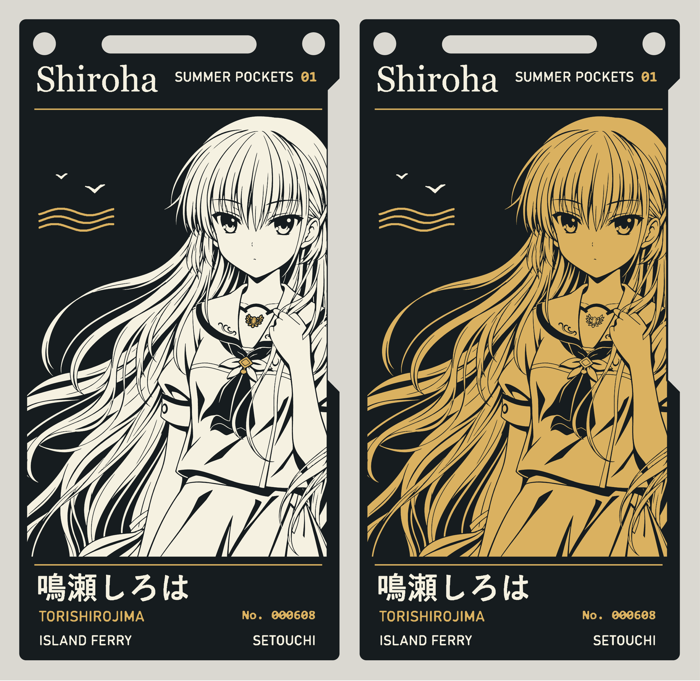
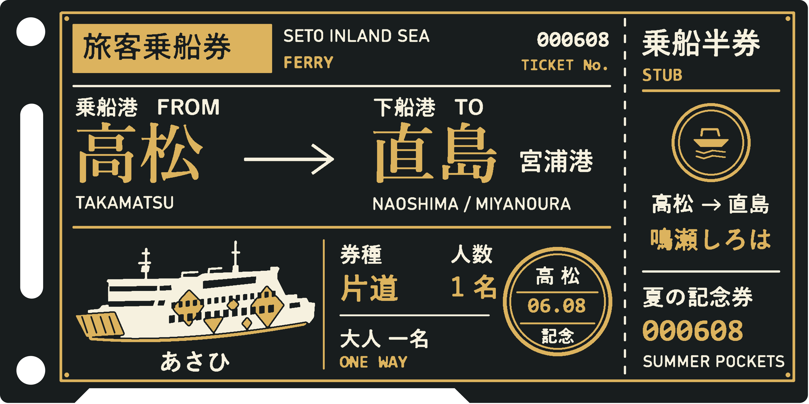
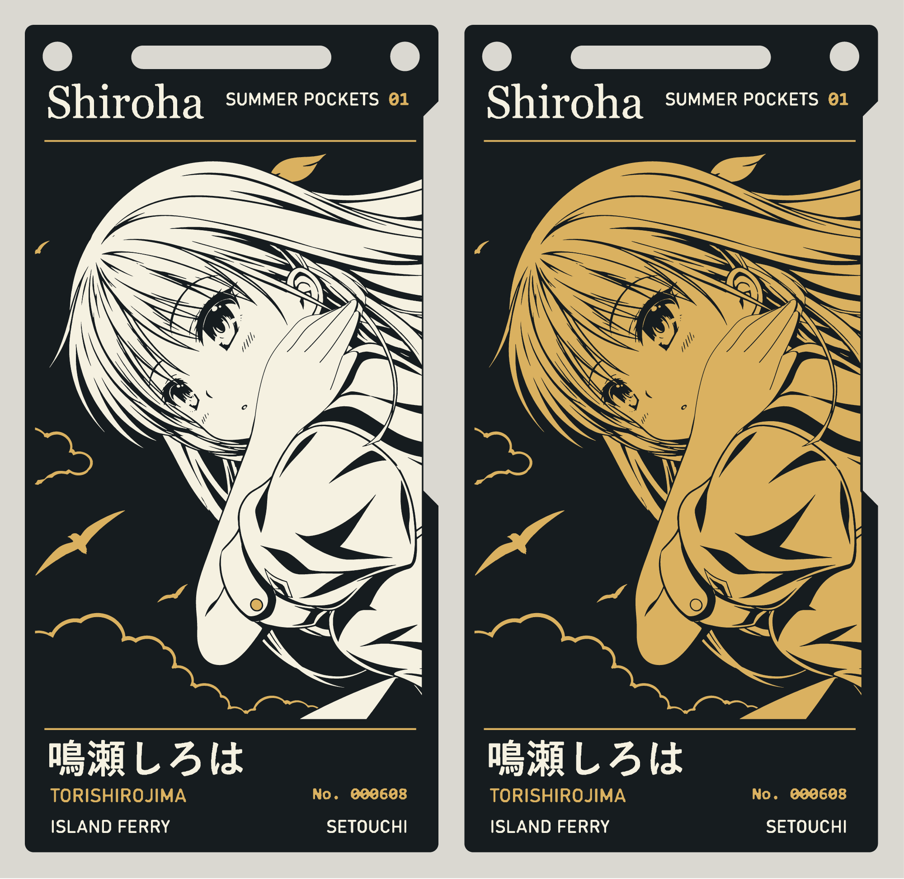
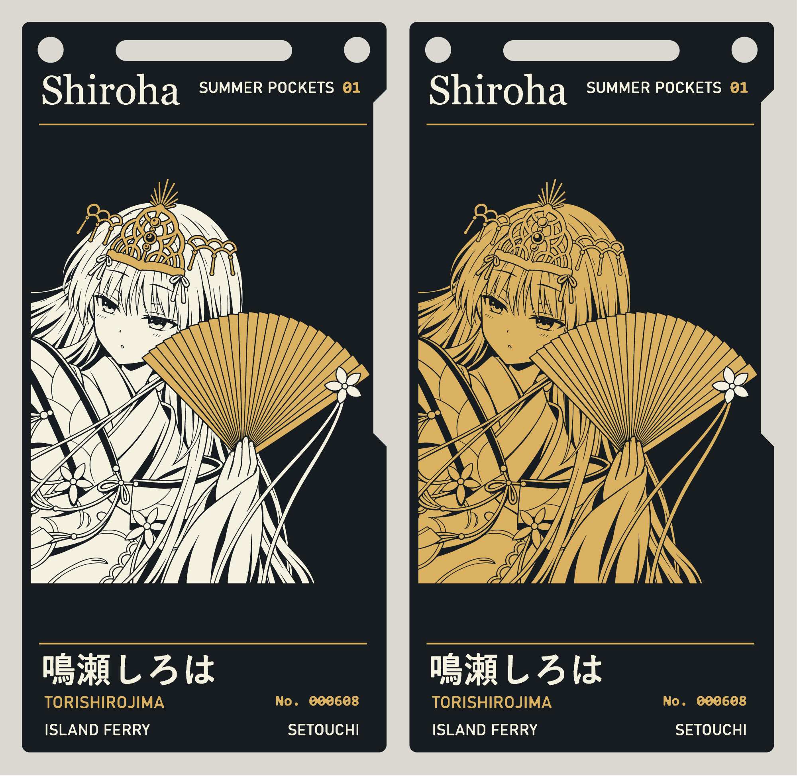
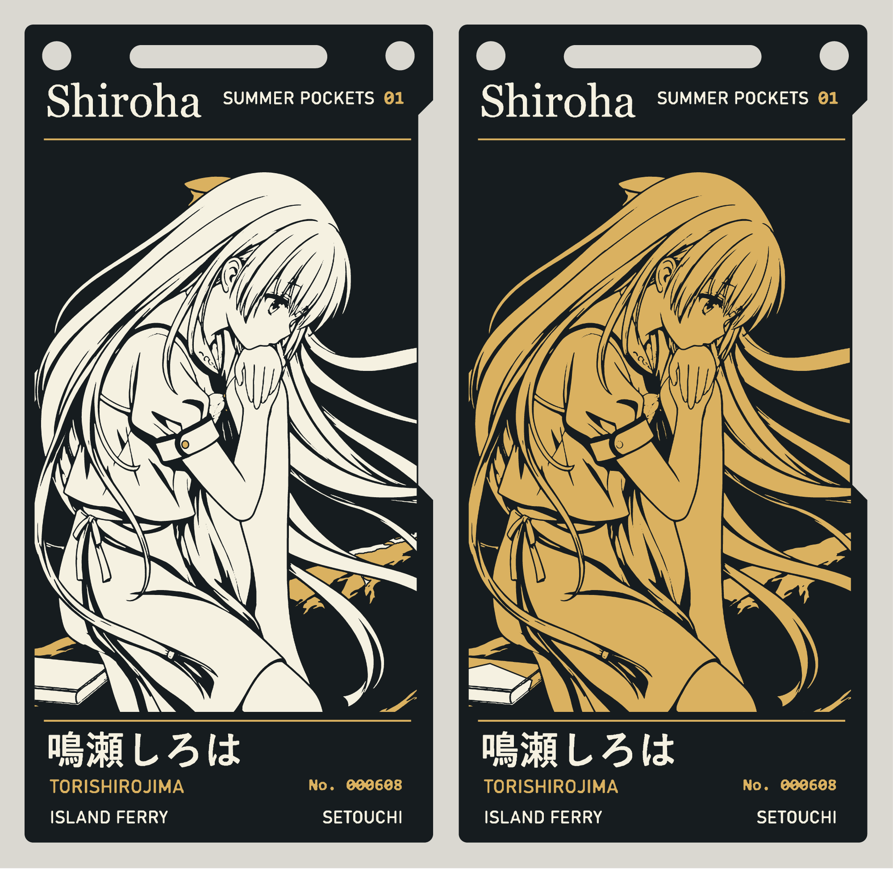
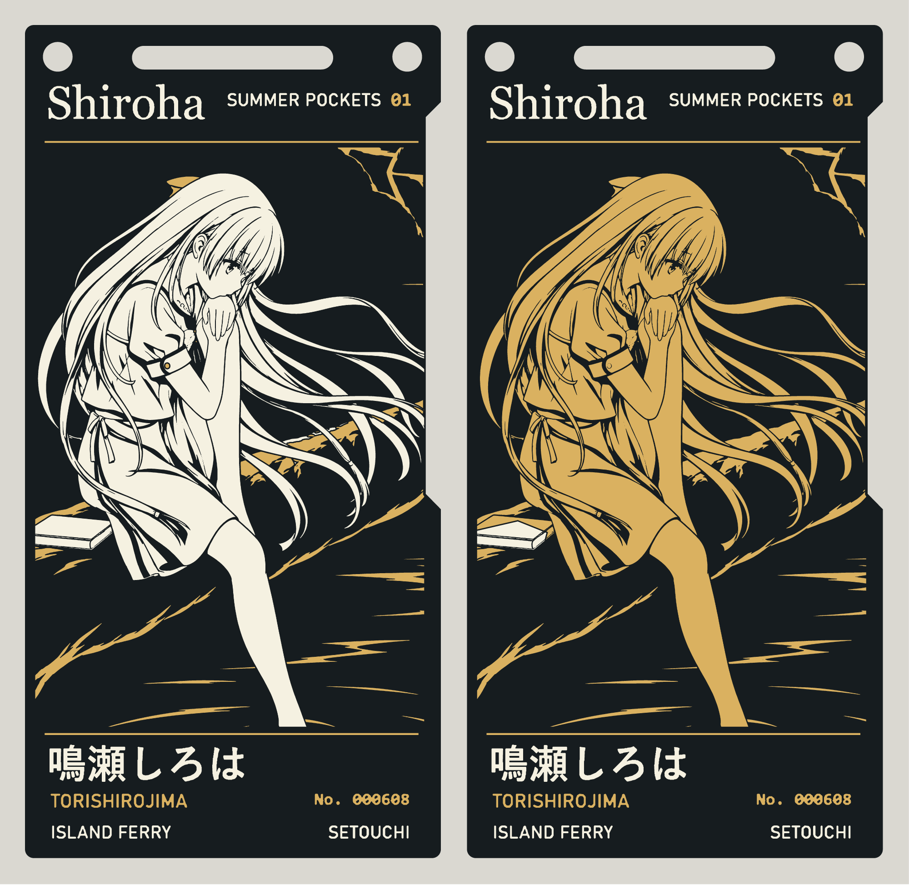
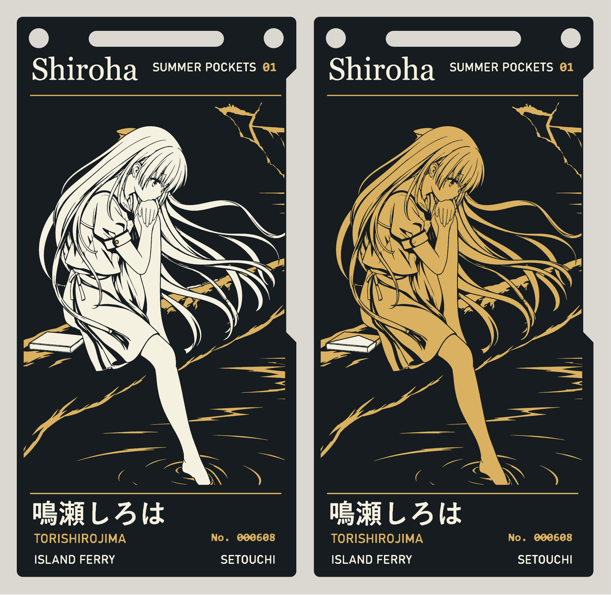
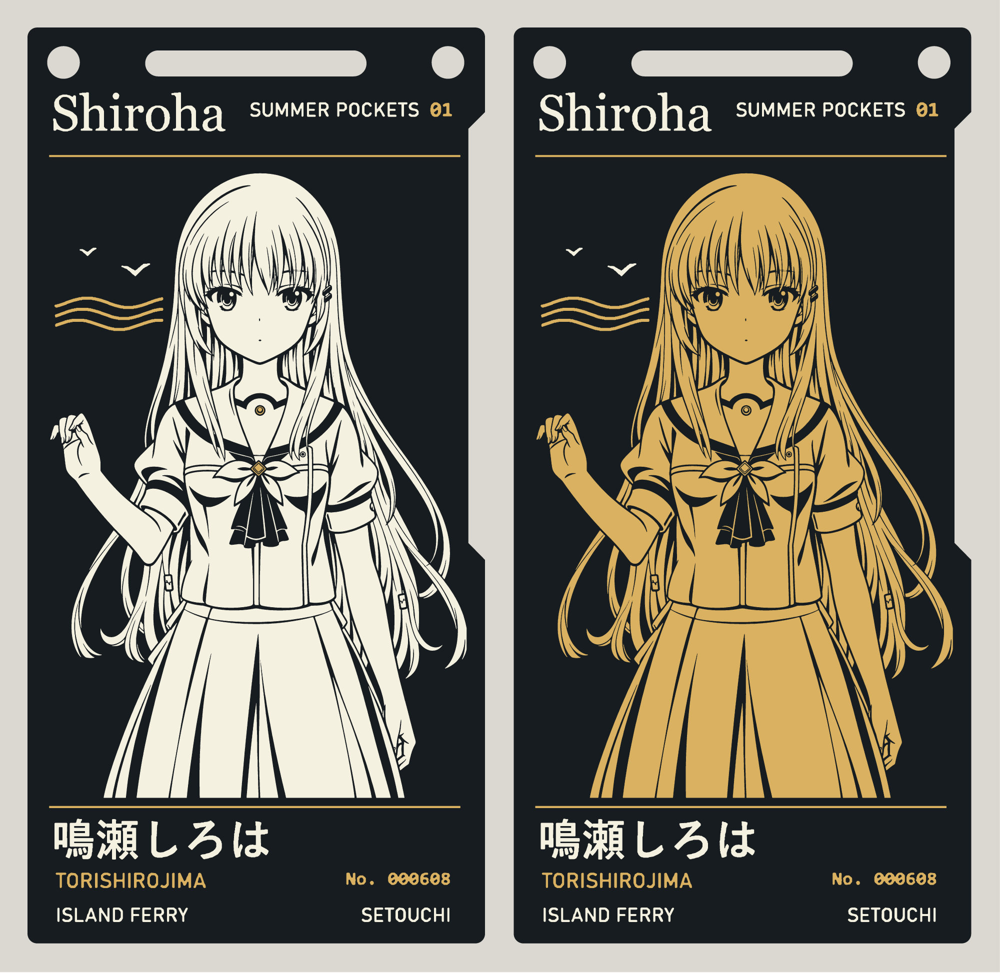

# 鸣濑白羽 · 濑户内船票 PCB

[简体中文](README.md) · [English](README.en.md) · [日本語](README.ja.md)

**游戏立绘** · 左：人物黑白、配饰点金；右：人物黑金。点击图片查看大图。

[黑白工程](boards/game/game.epro2) · [黑白 Gerber](boards/game/gerber.zip) · [黑金工程](boards-character-gold/game/game.epro2) · [黑金 Gerber](boards-character-gold/game/gerber.zip)

当前制造版本为 **v1.3.4**。本公开仓库仅提供当前版本；历史版本保存在私有存档中。七款各有黑白和黑金两种配色，共十四套双面 PCB。下方均为对应制造图层渲染的整板展示。

[下载全部打板文件](https://github.com/shiroha777777/shiroha-ferry-pcb/releases/download/v1.3.4/Shiroha-14-Gerbers.zip) · [黑白工程合集](https://github.com/shiroha777777/shiroha-ferry-pcb/releases/download/v1.3.4/Shiroha-Black-White-Accessories-7.zip) · [黑金工程合集](https://github.com/shiroha777777/shiroha-ferry-pcb/releases/download/v1.3.4/Shiroha-Character-Black-Gold-7.zip) · [1200 dpi 正反面 PNG](https://github.com/shiroha777777/shiroha-ferry-pcb/releases/download/v1.3.4/Shiroha-1200dpi-PNG.zip)

v1.3.4 已修复游戏款拢发的手部，并按蓝天原图调整指尖、指缝和掌侧曲线。金扇款的扇面与头饰为沉金，扇子上的花保留白丝印。黑白、黑金工程、Gerber 和下方大图均已同步，直接更新原 v1.3.4 tag。沿用约 0.32 mm 板边退让。[制造说明](FABRICATION.md) · [本次修订核验](art-revision-review.json) · [游戏手部核验](hand-repair-review.json)

## 背板

七款黑白、黑金共用此背板：高松 → 直島・宮浦，船名「あさひ」，日期 06.08。图片由实际背面 Gerber 渲染，点击可查看大图。

## 其他款式

每张图左侧为黑白款，右侧为黑金款。

### 蓝天

[黑白工程](boards/blue-sky/blue-sky.epro2) · [黑白 Gerber](boards/blue-sky/gerber.zip) · [黑金工程](boards-character-gold/blue-sky/blue-sky.epro2) · [黑金 Gerber](boards-character-gold/blue-sky/gerber.zip)

### 金扇

两种配色均为金色扇面、黑色扇骨线、白色花饰。

[黑白工程](boards/golden-fan/golden-fan.epro2) · [黑白 Gerber](boards/golden-fan/gerber.zip) · [黑金工程](boards-character-gold/golden-fan/golden-fan.epro2) · [黑金 Gerber](boards-character-gold/golden-fan/gerber.zip)

### 林间近景

[黑白工程](boards/riverside-close/riverside-close.epro2) · [黑白 Gerber](boards/riverside-close/gerber.zip) · [黑金工程](boards-character-gold/riverside-close/riverside-close.epro2) · [黑金 Gerber](boards-character-gold/riverside-close/gerber.zip)

### 林间中景

[黑白工程](boards/riverside-medium/riverside-medium.epro2) · [黑白 Gerber](boards/riverside-medium/gerber.zip) · [黑金工程](boards-character-gold/riverside-medium/riverside-medium.epro2) · [黑金 Gerber](boards-character-gold/riverside-medium/gerber.zip)

### 林间全景

[黑白工程](boards/riverside-wide/riverside-wide.epro2) · [黑白 Gerber](boards/riverside-wide/gerber.zip) · [黑金工程](boards-character-gold/riverside-wide/riverside-wide.epro2) · [黑金 Gerber](boards-character-gold/riverside-wide/gerber.zip)

### 动画立绘

[黑白工程](boards/anime/anime.epro2) · [黑白 Gerber](boards/anime/gerber.zip) · [黑金工程](boards-character-gold/anime/anime.epro2) · [黑金 Gerber](boards-character-gold/anime/gerber.zip)

## 打样

在七款制造总包中选 standard（黑白）或 variant（黑金），上传对应款的单个 Gerber ZIP。采用双层 FR-4、1.6 mm、1 oz、黑阻焊、白丝印和沉金。背面已按制造坐标写入，可以在 Gerber 查看器切到底面核对文字。PNG 用于查看和按物理尺寸打印。

本版优先保留绘画细节，不再以“比红莉栖更容易加工”为约束。细发、眼睛、冠饰和扇骨中保留了小于常规加工线宽／间距的部分；文件已生成并校验，但未取得工厂 CAM 接单确认或实板验证，不能把细节保留版称为全项 DFM 通过。完整图案由工厂实际能力决定。

已逐点核对十四份工程的六个制造层与 Gerber 一致，顶面铜与阻焊开窗一致，板框、钻孔及三个背面图层与 v1.3.1 完全一致。白丝印与露铜之间保留约 0.155 mm 退让，图案内部细线不再强制删粗。[制造说明与逐款筛查](FABRICATION.md) · [原始核验数据](manufacturing-review.json) · [嘉立创加工能力](https://www.jlc.com/portal/vtechnology.html)

## 参考项目与致谢

本项目参考了 [observer0703 的牧濑红莉栖沉金 PCB（Kurisu ENIG PCB）](https://github.com/observer0703/-kurisu-enig-pcb)，使用的参考版本为 [v1.0.0（工程文件与制板说明）](https://github.com/observer0703/-kurisu-enig-pcb/releases/tag/v1.0.0)。感谢作者公开工程与制作经验。

板形、挂绳孔槽与底板工程沿用该参考工程，并参考其黑色阻焊、白色丝印与沉金的图层表现方式。鸣濑白羽人物图形、文字和正反面船票版式在此基础上重新设计。上游设计与角色素材的权利范围见 [来源说明](NOTICE.md)。

相关参考还包括 [adenzhou1350 的 ENIG PCB Art · 黑金 PCB 作品集](https://github.com/adenzhou1350/enig-pcb-art)。该仓库整理了黑金 PCB 作品、材料分层、工程构建工具与复刻流程，感谢作者公开设计与制作资料。

## 来源与许可

本项目原创的船票版式、分层制图和 PCB 修改采用 CERN-OHL-P-2.0。角色与原画的权利归各自权利人。[来源及范围](NOTICE.md) · [许可证](LICENSE)
